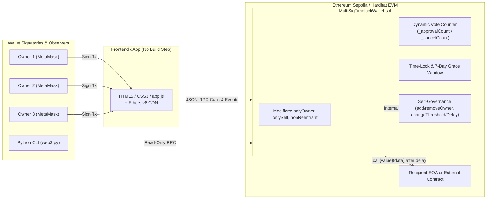
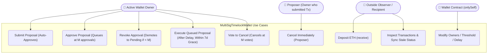
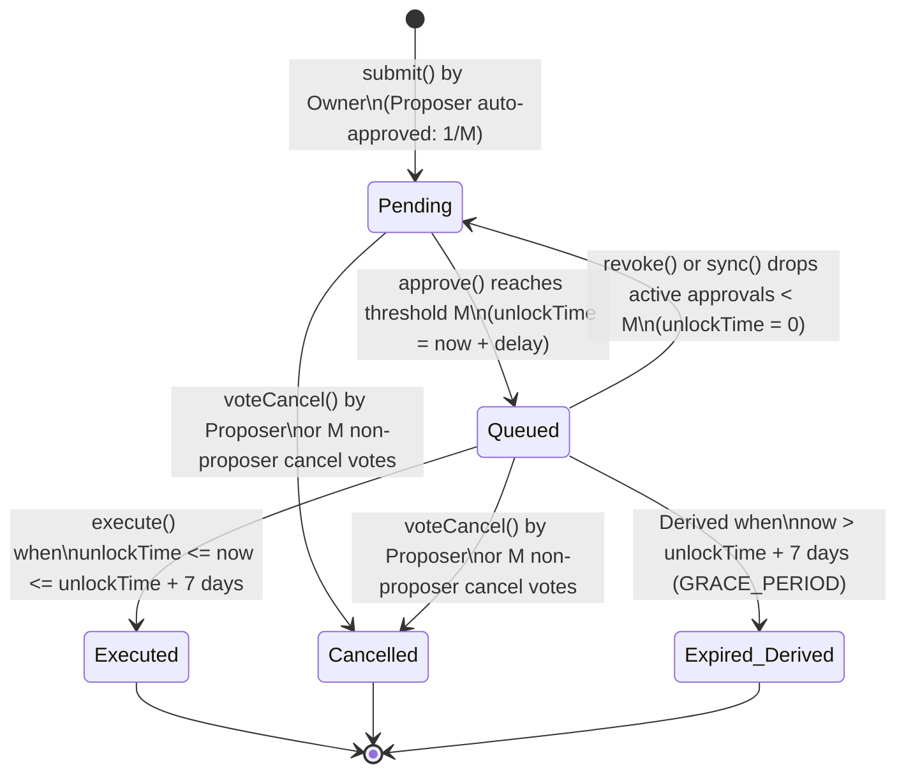
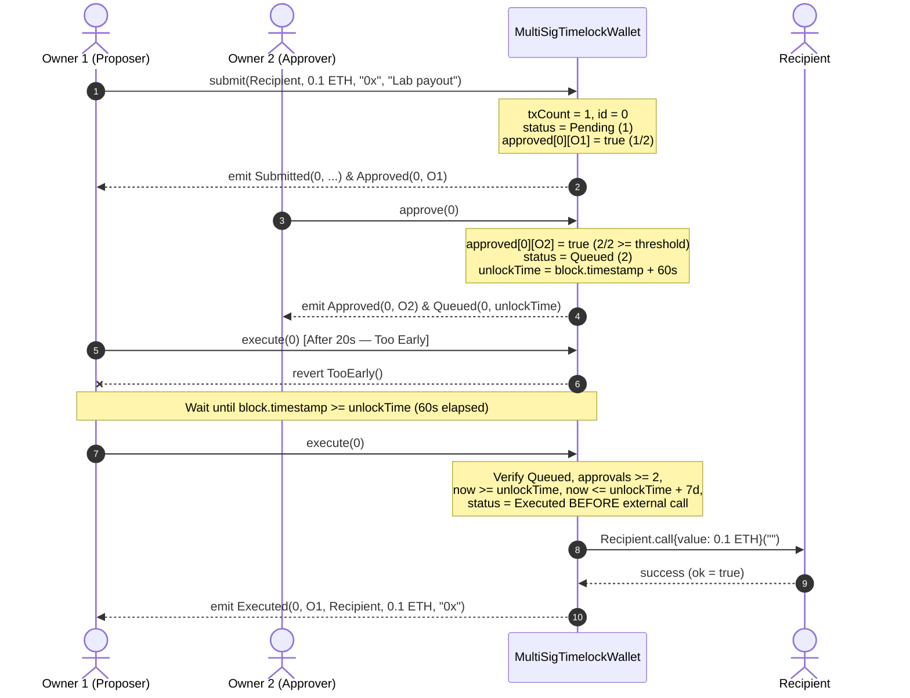

# System Design Document — MultiSigTimelockWallet

---

## 1. System Architecture Diagram

The system uses a three-tier Web3 architecture: owners interact with the browser dashboard through MetaMask, while `MultiSigTimelockWallet` on the Ethereum Sepolia Testnet enforces all consensus and time-lock rules on-chain.

---

## 2. Use-Case Diagram

---

## 3. Transaction State Machine Diagram

Note that `Expired` (`5`) is **not** written to storage; it is computed dynamically by `isExpired(id)` and `getStatus(id)` whenever `status == Status.Queued` and `block.timestamp > unlockTime + GRACE_PERIOD`.

---

## 4. Sequence Diagram — Propose, Approve, Wait, Execute

---

## 5. EVM Storage Layout Table

| Slot / Variable | Solidity Type | Visibility | Description |
| :--- | :--- | :--- | :--- |
| `MAX_OWNERS` | `uint256 constant` | `public` | Constant (`10`) embedded in bytecode (no storage slot). |
| `GRACE_PERIOD` | `uint256 constant` | `public` | Constant (`7 days = 604800`) embedded in bytecode. |
| `MIN_DELAY` | `uint256 constant` | `public` | Constant (`10 seconds`) embedded in bytecode. |
| `MAX_DELAY` | `uint256 constant` | `public` | Constant (`30 days = 2592000`) embedded in bytecode. |
| Slot 0: `owners` | `address[]` | `public` | Dynamic array of active owner addresses (length $3 \dots 10$). |
| Slot 1: `isOwner` | `mapping(address => bool)` | `public` | $O(1)$ lookup table for active owner membership. |
| Slot 2: `threshold` | `uint256` | `public` | Required number of active owner approvals ($M$). |
| Slot 3: `delay` | `uint256` | `public` | Time-lock duration in seconds before a queued tx unlocks. |
| Slot 4: `txCount` | `uint256` | `public` | Monotonically increasing counter of submitted transactions. |
| Slot 5: `transactions` | `mapping(uint256 => Tx)` | `public` | Maps transaction ID to `Tx` struct (`to`, `value`, `data`, `note`, `proposer`, `unlockTime`, `status`). |
| Slot 6: `approved` | `mapping(uint256 => mapping(address => bool))` | `public` | Tracks whether a given address has approved transaction `id`. |
| Slot 7: `cancelVoted` | `mapping(uint256 => mapping(address => bool))` | `public` | Tracks whether a non-proposer owner voted to cancel transaction `id`. |
| Slot 8: `_locked` | `bool` | `private` | Reentrancy mutex lock used by the `nonReentrant` modifier. |

---

## 6. Complete Function Specification Table

| Function | Who Can Call | State Changes | Events Emitted |
| :--- | :--- | :--- | :--- |
| `constructor(owners_, threshold_, delay_)` | Deployer (once) | Sets `owners`, `isOwner`, `threshold`, `delay` | *(None)* |
| `receive()` | Anyone | Increases contract ETH balance | `Deposited(sender, amount, balanceAfter)` |
| `submit(to, value, data, note)` | `onlyOwner` | Increments `txCount`, stores `Tx` as `Pending`, sets `approved[id][msg.sender] = true` | `Submitted`, `Approved` |
| `approve(id)` | `onlyOwner` | Sets `approved[id][msg.sender] = true`; if `Pending` and approvals $\ge$ `threshold`, sets `Queued` and `unlockTime` | `Approved`, `Queued` *(if threshold reached)* |
| `revoke(id)` | `onlyOwner` | Sets `approved[id][msg.sender] = false`; if `Queued` and approvals $<$ `threshold`, sets `Pending` and `unlockTime = 0` | `Revoked` |
| `sync(id)` | Anyone | If `Queued` and active approvals $<$ `threshold`, sets `Pending` and `unlockTime = 0` | *(None)* |
| `execute(id)` | `onlyOwner` (`nonReentrant`) | Sets `status = Executed`, transfers ETH / runs calldata on `to` | `Executed` *(plus any inner governance event)* |
| `voteCancel(id)` | `onlyOwner` | Records `cancelVoted[id][msg.sender] = true` (if not proposer); sets `status = Cancelled` and `unlockTime = 0` if proposer or votes $\ge$ `threshold` | `Cancelled` *(when cancelled)* |
| `addOwner(newOwner)` | `onlySelf` | Sets `isOwner[newOwner] = true`, pushes to `owners` | `OwnerAdded(newOwner)` |
| `removeOwner(ownerToRemove)` | `onlySelf` | Sets `isOwner[ownerToRemove] = false`, swap-and-pops from `owners` | `OwnerRemoved(ownerToRemove)` |
| `changeThreshold(newThreshold)` | `onlySelf` | Updates `threshold = newThreshold` | `ThresholdChanged(newThreshold)` |
| `changeDelay(newDelay)` | `onlySelf` | Updates `delay = newDelay` | `DelayChanged(newDelay)` |
| `getOwners()`, `getTransaction(id)`, `getStatus(id)`, `timeLeft(id)`, `isExpired(id)`, `approvalCount(id)`, `cancelCount(id)` | Anyone (`view`) | Read-only (no state change) | *(None)* |
